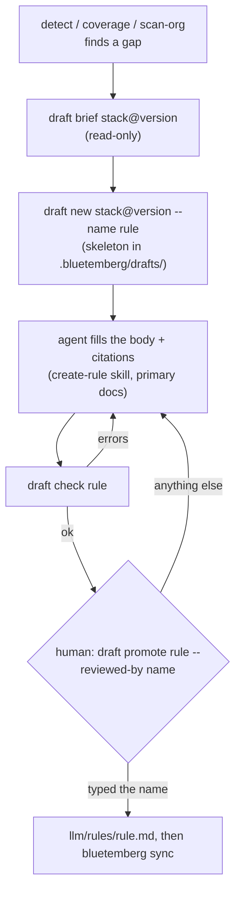

# Drafts: the human-gated create-loop

When detection finds a stack version that no rule covers (a **gap**), Bluetemberg can help an agent draft a rule for it. The engine never writes the rule itself, and it never calls a model. It hands the agent structured grounding, checks what comes back, and leaves the final decision to a human at a terminal.

A wrong rule is worse than a gap: it misleads every AI session that loads it. So the loop is built around one rule. **Nothing a model wrote reaches `llm/` until a human has read it and typed its name.**



## The flow

```bash
npx bluetemberg detect                                  # gaps: payload 4.0.1 — gap: no coverage
npx bluetemberg draft brief payload@4.0.1               # grounding for the agent (read-only)
npx bluetemberg draft new payload@4.0.1 --name payload-4-jobs-queue
# … an agent fills .bluetemberg/drafts/payload-4-jobs-queue.md …
npx bluetemberg draft check payload-4-jobs-queue        # repeat until it reports OK
npx bluetemberg draft promote payload-4-jobs-queue --reviewed-by jravas   # human only
npx bluetemberg sync
```

An agent can drive every step up to `draft check`. `draft promote` needs an interactive terminal, so an agent's tool calls stop there.

## The brief

`draft brief <stack>@<version>` is what an agent reads before writing. Everything in it is computed by the engine:

- **The gap.** The stack, version, why it is a gap (`no-coverage`, `version-uncovered`, or `name-level-only`), and how confidently the version was detected. A `coerced` or `unknown` version gets a warning: version boundaries are where drafts go wrong.
- **The proposed range.** The gap version's release line: `>=4 <5`, or `>=0.81 <0.82` for a 0.x stack.
- **The npm package.** Taken from the [stack map](Stacks#the-stack-map-which-package-is-a-stack).
- **The nearest existing guidance.** The same data `stacks list` shows.
- **Evidence.** Up to 20 **paths** of project files that import the package. The brief lists paths, never file contents: the agent reads the code itself.
- **The citation contract and the next steps.** Next steps follow the `create-rule` skill's house structure.

When the version is already covered by version-specific guidance, the brief says so and exits 1. `draft new` refuses outright. The loop never drafts without a gap.

## Where drafts live

Drafts live in **`.bluetemberg/drafts/`**:

- The directory is gitignored in every project.
- Sync never reads it, and neither does anything that reads `llm/`.
- Promoted drafts are archived in `.bluetemberg/drafts/promoted/`, together with the reviewer, the time and the hash of what they approved.
- `uninstall` and `eject` delete `.bluetemberg/`, drafts included.

A draft is a rule file plus a `draft:` block:

```yaml
---
description: Queue background work through the Payload jobs collection.
scope: "src/**"
stacks:
  payload: ">=4 <5"
draft:
  status: draft-unvetted
  kind: rule
  gap: { stack: payload, version: 4.0.1, reason: no-coverage, confidence: exact }
  createdAt: 2026-11-04T10:00:00.000Z
  engine: bluetemberg@0.19.0
  reviewedBy: null
  citations:
    - url: https://payloadcms.com/docs/jobs-queue/overview
      quote: "verbatim sentence from that page"
      retrieved: 2026-11-04
---
```

**The `draft:` key is reserved.** A file carrying it is withheld from every platform, whatever its value. That holds even inside `llm/rules/`: sync skips the file with a warning, and so do guardrails, `bluetemberg why` and marketplace bundles. Promotion is the only path that removes the key.

## `draft check`

`draft check` is read-only and safe for an agent to run in a loop. It exits 1 on errors.

| Check | Fails when |
| ----- | ---------- |
| Strict frontmatter | The fence is not exactly `---`, the YAML has aliases or duplicate keys, or a key other than `description`, `scope`, `stacks` or `draft` is present |
| Placeholders | Any `TODO(draft)` marker is left |
| Hidden characters | The draft contains characters a reviewer cannot see but a model reads: zero-width, bidi, Unicode tag characters, private-use characters or variation selectors |
| Range | The gap stack has no range, the range is open-ended or a wildcard, or it does not satisfy the gap version |
| Citations | There are none. A URL is not `https`, carries credentials, or names an IP, `localhost` or a private host. A quote is empty or longer than 500 characters. A `retrieved` date is not a date, or is in the future |
| Review marker | `draft.reviewedBy` is set. Only `promote` records a reviewer |
| Body | It is empty, or larger than 16 KiB |
| Security scan | The [pack content scanner](Registry) blocks it. Prompt-override, safety-bypass, dangerous agent flags and exfiltration are always errors in a draft, even inside a fence labelled as a BAD example |
| Gap still open | Version-specific guidance has appeared since the draft was opened |

**No citation means no promotion.** A draft grounded only in project code stays a draft.

## `draft promote` — the human gate

`draft promote <name> --reviewed-by <who>`:

1. Refuses without an interactive terminal. It also refuses inside an agent session: when `CLAUDECODE`, `CURSOR_AGENT`, `GEMINI_CLI` or `CODEX_SANDBOX` is set, because an agent can wrap the command in a pseudo-terminal. It has no `--yes`, and there is no MCP equivalent.
2. Re-runs every check, and refuses on any error.
3. Prints the exact rule file it will write. Control and bidi characters are neutralised before display. It also prints the citations and any warnings.
4. Asks you to **type the rule name**. Anything else cancels.
5. Re-reads the draft and compares its SHA-256 with what you reviewed. If one byte changed, nothing is written.
6. Writes `<source>/rules/<name>.md` with exclusive create, so it never overwrites. The target must be inside the project, with no symlink on the way. The written file has only `description`, `scope` and `stacks`, plus a `## Sources` section listing the citations.
7. Archives the draft with `reviewedBy`, `reviewedAt` and the hash.

The gate stops an agent from promoting through its normal tool use, whether by mistake or under a prompt injection. The agent-session check is best-effort: a host that sets none of those variables is not detected. It is not a sandbox against someone at your keyboard, who could edit `llm/rules/` directly anyway.

## Drafts are data

Everything in the loop that touches a model is treated as untrusted. That covers the documentation the agent reads, and the draft it writes.

- Drafts are parsed by a strict, YAML-only reader. They are never executed, never synced, and never sent anywhere.
- Any value quoted from a draft in a message is sanitised and truncated.
- Every path is validated: names are kebab-case, symlinks are refused anywhere under the project, and writes use exclusive create. Writes land only in `.bluetemberg/drafts/` and, on promotion, in the one rule file.

## MCP

`bluetemberg mcp serve` adds two **read-only** tools:

- `bluetemberg_draft_brief` (`stack`, `version`)
- `bluetemberg_draft_check` (`name`)

No MCP tool writes or promotes a draft.

## Not yet

These are planned in [#197](https://github.com/prototypdigital/bluetemberg/issues/197):

- Verifying that each citation's quote really appears on its page.
- Skill and agent drafts.
- An optional contribution PR into bluetemberg-packs that a human runs.
- An eval gate (M8): promotion requires a passing promptfoo eval when the rule ships one.

## See also

- [Stacks & Versioning](Stacks): gaps, coverage and ranges
- [Writing Rules](Writing-Rules): the house structure a promoted rule follows
- [Commands → `bluetemberg draft`](Commands#bluetemberg-draft-subcommand)
