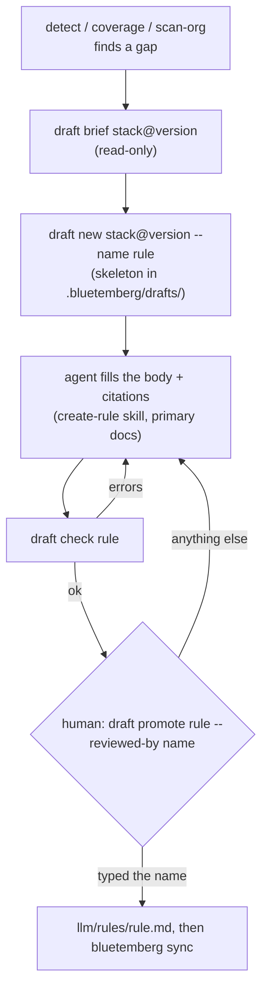

# Drafts: the human-gated create-loop

> **Since 0.20.0.**

When detection finds a stack version that no rule covers (a **gap**), Bluetemberg can help an agent draft a rule for it. The engine never writes the rule itself, and it never calls a model. It hands the agent structured grounding, checks what comes back, and leaves the final decision to a human at a terminal.

A wrong rule is worse than a gap: it misleads every AI session that loads it. So the loop is built around one rule. **Nothing a model wrote reaches `llm/` until a human has read it and typed its name.**



## The flow

```bash
npx bluetemberg detect                                  # gaps: payload 4.0.1 — gap: no coverage
npx bluetemberg draft brief payload@4.0.1               # grounding for the agent (read-only)
npx bluetemberg draft new payload@4.0.1 --name payload-4-jobs-queue
# … an agent fills .bluetemberg/drafts/payload-4-jobs-queue.md …
npx bluetemberg draft check payload-4-jobs-queue        # repeat until it reports OK
npx bluetemberg draft check payload-4-jobs-queue --verify-citations   # fetch the cited pages
npx bluetemberg draft promote payload-4-jobs-queue --reviewed-by jravas   # human only
npx bluetemberg sync
```

An agent can drive every step up to `draft check`. `draft promote` needs an interactive terminal, so an agent's tool calls stop there.

## The brief

`draft brief <stack>@<version>` is what an agent reads before writing. Everything in it is computed by the engine:

- **The gap.** The stack, version, why it is a gap (`no-coverage`, `version-uncovered`, or `name-level-only`), and how confidently the version was detected. A `coerced` or `unknown` version gets a warning: version boundaries are where drafts go wrong.
- **The proposed range.** The gap version's release line: `>=4 <5`, or `>=0.81 <0.82` for a 0.x stack.
- **The npm package.** Taken from the [stack map](Stacks#the-stack-map-which-package-is-a-stack).
- **The nearest existing guidance.** The same data `stacks list` shows.
- **Evidence.** Up to 20 **paths** of project files that import the package. The brief lists paths, never file contents: the agent reads the code itself.
- **The citation contract and the next steps.** Next steps follow the `create-rule` skill's house structure.

When the version is already covered by version-specific guidance, the brief says so and exits 1. `draft new` refuses outright. The loop never drafts without a gap.

## Rules, skills and agents

A gap can be filled by any of the three kinds that take a `stacks:` range. Pass `--kind` to `draft brief` and `draft new`; the default is `rule`.

| Kind | Frontmatter it may carry | Body should have | Promoted to | Authoring skill |
| ---- | ------------------------ | ---------------- | ----------- | --------------- |
| `rule` | `description`, `scope`, `stacks` | `## Rules` | `<source>/rules/<name>.md` | `create-rule` |
| `skill` | `name`, `description`, `stacks` | `## Protocol` | `<source>/skills/<name>/SKILL.md` | `create-skill` |
| `agent` | `name`, `description`, `tools`, `stacks` | `## Constraints` | `<source>/agents/<name>.md` | `create-agent` |

- **`name`** must equal the draft name. It becomes the skill directory or the agent id.
- **A skill draft is one `SKILL.md`.** Scripts and other supporting files cannot be drafted. Add them by hand after promotion, where you review them like any other change.
- **An agent draft must list its `tools`.** An agent without `tools` inherits every tool its host has, which no reviewer can read off the file. Only the abstract names `read`, `search`, `edit`, `execute` and `agent` are allowed: a host tool name such as `Bash`, a wildcard or an MCP tool is refused. The skeleton starts read-only (`[read, search]`). Granting `edit`, `execute` or `agent` raises a `tools-write-access` warning, and the promote review shows the tools on their own line.
- **Size caps:** a rule body is capped at 16 KiB (it is always-on context). A skill or agent body is capped at 32 KiB.

```bash
npx bluetemberg draft new payload@4.0.1 --kind skill --name payload-4-jobs-setup
npx bluetemberg draft new payload@4.0.1 --kind agent --name payload-4-jobs-reviewer
```

## Where drafts live

Drafts live in **`.bluetemberg/drafts/`**:

- The directory is gitignored in every project.
- Sync never reads it, and neither does anything that reads `llm/`.
- Promoted drafts are archived in `.bluetemberg/drafts/promoted/`, together with the reviewer, the time and the hash of what they approved.
- `uninstall` and `eject` delete `.bluetemberg/`, drafts included.

A draft is the file it will become plus a `draft:` block. For a rule:

```yaml
---
description: Queue background work through the Payload jobs collection.
scope: "src/**"
stacks:
  payload: ">=4 <5"
draft:
  status: draft-unvetted
  kind: rule
  gap: { stack: payload, version: 4.0.1, reason: no-coverage, confidence: exact }
  createdAt: 2026-11-04T10:00:00.000Z
  engine: bluetemberg@0.20.0
  reviewedBy: null
  citations:
    - url: https://payloadcms.com/docs/jobs-queue/overview
      quote: "verbatim sentence from that page"
      retrieved: 2026-11-04
---
```

**The `draft:` key is reserved.** A file carrying it is withheld from every platform, whatever its value. That holds even inside `llm/rules/`: sync skips the file with a warning, and so do guardrails, `bluetemberg why` and marketplace bundles. Promotion is the only path that removes the key.

## `draft check`

`draft check` is read-only and safe for an agent to run in a loop. It exits 1 on errors.

| Check | Fails when |
| ----- | ---------- |
| Strict frontmatter | The fence is not exactly `---`, the YAML has aliases or duplicate keys, or a key outside the kind's allowed set (see the table above) or `draft` is present |
| Placeholders | Any `TODO(draft)` marker is left |
| Hidden characters | The draft contains characters a reviewer cannot see but a model reads: zero-width, bidi, Unicode tag characters, private-use characters or variation selectors |
| Range | The gap stack has no range, the range is open-ended or a wildcard, or it does not satisfy the gap version |
| Citations | There are none. A URL is not `https`, carries credentials, or names an IP, `localhost` or a private host. A quote is shorter than 20 or longer than 500 characters. A `retrieved` date is not a date, or is in the future |
| Review marker | `draft.reviewedBy` is set. Only `promote` records a reviewer |
| Body | It is empty, or larger than its kind's cap (16 KiB for a rule, 32 KiB for a skill or agent) |
| Security scan | The [pack content scanner](Registry) blocks it. Prompt-override, safety-bypass, dangerous agent flags and exfiltration are always errors in a draft, even inside a fence labelled as a BAD example |
| Gap still open | Version-specific guidance has appeared since the draft was opened |

**No citation means no promotion.** A draft grounded only in project code stays a draft.

### `--verify-citations`

`draft check --verify-citations` checks that each citation is *true*, not just well-formed:

- **The quote must be on the page.** Each cited page is fetched and its visible text searched for the quote. Matching ignores tags, entities, typographic quotes and dashes, markdown code and emphasis marks, whitespace and case. Text that exists only inside `<script>`, `<style>` or HTML comments does not count. An invented URL or a paraphrase fails with `citation-quote-not-found`; a page that cannot be loaded fails with `citation-unreachable`.
- **At least one citation must be primary.** The stack's npm package lists a `homepage` and a `repository`, and `raw.githubusercontent.com` counts as the repository. A citation from anywhere else, such as a blog or a mirror, gets a `citation-not-primary` warning for the reviewer. When none of the citations is primary, the check fails with `citations-no-primary`. When npm cannot be reached, a `doc-sources-unknown` warning says the source was not checked.

The fetch is the only network read in the loop, and it treats the URL as hostile:

- **https only.** The default port and a public host name are required, and every redirect hop is checked the same way (at most 5).
- **Public addresses only.** The host must resolve to public addresses only. The check runs inside the connection's own DNS lookup, so a name cannot pass and then rebind to `127.0.0.1` or a cloud metadata address.
- **No credentials.** No cookies, credentials or proxy are sent.
- **Bounded.** Each fetch, redirects included, has a hard 15-second limit, even against a server that drips one byte at a time, and reads at most 5 MiB. Text extraction is a single linear pass, so hostile markup cannot stall it.

The page is only searched for the quote. It is never stored, logged, or passed to a model.

## `draft promote` — the human gate

`draft promote <name> --reviewed-by <who>`:

1. Refuses without an interactive terminal. It also refuses inside an agent session: when `CLAUDECODE`, `CURSOR_AGENT`, `GEMINI_CLI` or `CODEX_SANDBOX` is set, because an agent can wrap the command in a pseudo-terminal. It has no `--yes`, and there is no MCP equivalent.
2. Re-runs every check, **verifies every citation against its page** (as `--verify-citations` does), and refuses on any error. Offline, a human can pass `--skip-citation-verification`; the review then warns that the quotes were not checked, and the archive records `citationsVerified: false`.
3. Prints the exact rule file it will write. Control and bidi characters are neutralised before display. It also prints the citations and any warnings.
4. Asks you to **type the rule name**. Anything else cancels.
5. Re-reads the draft and compares its SHA-256 with what you reviewed. If one byte changed, nothing is written.
6. Writes the file for its kind (see the table above) with exclusive create, so it never overwrites; a skill's directory must not exist at all. The target must be inside the project, with no symlink on the way. The written file has only its kind's frontmatter keys, plus a `## Sources` section listing the citations.
7. Archives the draft with `reviewedBy`, `reviewedAt` and the hash.

The gate stops an agent from promoting through its normal tool use, whether by mistake or under a prompt injection. The agent-session check is best-effort: a host that sets none of those variables is not detected. It is not a sandbox against someone at your keyboard, who could edit `llm/rules/` directly anyway.

## Drafts are data

Everything in the loop that touches a model is treated as untrusted. That covers the documentation the agent reads, and the draft it writes.

- Drafts are parsed by a strict, YAML-only reader. They are never executed, never synced, and never sent anywhere.
- Any value quoted from a draft in a message is sanitised and truncated.
- Every path is validated: names are kebab-case, symlinks are refused anywhere under the project, and writes use exclusive create. Writes land only in `.bluetemberg/drafts/` and, on promotion, in the one rule file.

## MCP

`bluetemberg mcp serve` adds two **read-only** tools:

- `bluetemberg_draft_brief` (`stack`, `version`, optional `kind`)
- `bluetemberg_draft_check` (`name`, optional `verifyCitations`)

No MCP tool writes or promotes a draft.

## Contributing to bluetemberg-packs

`draft pr <name> --packs-repo <dir>` turns a promoted draft into a contribution branch in your local bluetemberg-packs checkout. Like `promote`, it refuses inside an agent session, because it writes to another repository.

What it does, all checks first:

1. **Reads the archive.** It must record a human review: reviewer, time and hash.
2. **Re-checks the promoted file as it is now.** That is your kind's house format, no `draft` key, the hidden-character check and the security scan. If you edited the file after review, it is still contributed, and the PR body says so.
3. **Fetches `origin/main`** and works from it, not from your local branch.
4. **Picks the pack.** That is the one pack of the right kind (`bluetemberg-rules-*`, `-skills-*` or `-agents-*`) whose `package.json` declares the gap stack. If none or several match, pass `--pack`. A brand-new pack is not scaffolded: create it with the `create-pack` skill first.
5. **Refuses a name already used for the same kind in any pack** on `origin/main`.
6. **Creates the branch.** It needs a clean working tree, and it creates `feat/<kind>-<name>` off `origin/main`.
7. **Writes the file** with exclusive create, and stages it.
8. **Writes the PR body** to `.bluetemberg/drafts/promoted/<name>.pr.md`. It covers the kind, pack, gap and range, the reviewer and time, the reviewed hash, whether citations were verified, whether the file was edited after review, and each citation with its quote. Every value that came from the draft sits in a code span or block, so it cannot render as markup or notify anyone through an `@mention`.

It **never commits, pushes, or opens the PR**, and it never runs the packs repo's own scripts. Committing runs that repo's hooks, and `catalog.json` must be regenerated by the packs repo's generator first. It prints the rest for you:

```bash
cd ../bluetemberg-packs
npm run generate:catalog
git add catalog.json
git commit -m 'feat(packs): add payload-4-jobs rule for payload >=4 <5'
git push -u origin 'feat/rule-payload-4-jobs'
gh pr create --draft --base main --head 'feat/rule-payload-4-jobs' --label needs-review --title '…' --body-file '…/payload-4-jobs.pr.md'
```

The PR is a **draft** labelled `needs-review`: a maintainer verifies it against the cited docs before it merges.

## Not yet

Planned in [#197](https://github.com/prototypdigital/bluetemberg/issues/197):

- An eval gate (M8): promotion requires a passing promptfoo eval when the rule ships one.

## See also

- [Stacks & Versioning](Stacks): gaps, coverage and ranges
- [Writing Rules](Writing-Rules): the house structure a promoted rule follows
- [Commands → `bluetemberg draft`](Commands#bluetemberg-draft-subcommand)
