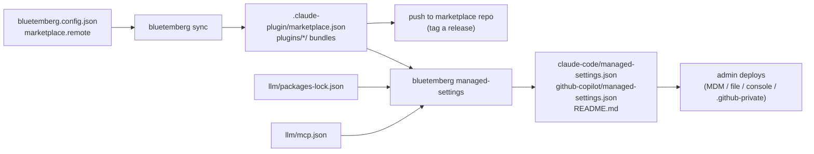

# Org rollout with managed settings

[Marketplace](Marketplace) output reaches a team through each repository's `.claude/settings.json`: a teammate who opens the project and trusts the folder is prompted to install the plugins. To install the same plugins for everyone in an organization, whatever repository they open, deploy them as **managed settings**: an org policy file that Claude Code and GitHub Copilot read above every user and project setting.

`bluetemberg managed-settings` writes those files from the project's config and lockfile. It does not install them. An admin deploys them with MDM, a file push or the host's own admin console. `bluetemberg sync` never writes them, and the command adds nothing to `bluetemberg.config.json`.



## Prerequisites

1. `marketplace.remote` is set to the GitHub `owner/repo` that hosts the published plugins. Without it the command refuses to run.
2. `bluetemberg sync` has generated `.claude-plugin/marketplace.json` and the `plugins/` bundles: `claude-marketplace` in `platforms` for Claude Code, `agent-plugins` for Copilot.
3. That output is pushed to the marketplace repo. Tag the commit if you want to pin it (`--ref`).

## Generate the files

```bash
npx bluetemberg managed-settings --ref v1.4.0 --out managed-settings
```

The output directory holds one file per host and a README that says where each file goes on macOS, Linux and Windows, which other delivery methods the host supports, and which pack versions the bundles were built from. Preview without writing with `--dry-run`; get the plan as JSON with `--json`. All flags are in [Commands](Commands#bluetemberg-managed-settings-directory).

## What goes into the files

| Key | Written | Derived from |
| - | - | - |
| `extraKnownMarketplaces` | Always | The marketplace `name` in `.claude-plugin/marketplace.json`, the repo in `marketplace.remote`, `--ref`, `--auto-update` |
| `enabledPlugins` | Always | Every plugin the index lists (`plugin@marketplace: true`), or the `--plugin` selection |
| `strictKnownMarketplaces` | With `--strict` | Your marketplace with the same `ref`, plus each `--allow-marketplace`. The Claude Code file adds `{ "source": "skills-dir" }` |
| `allowedMcpServers` | With `--mcp-allowlist` | The servers in `llm/mcp.json` (presets resolved) and the root `.mcp.json`, as exact `serverCommand` or `serverUrl` matchers |
| `deniedMcpServers` | Never | Nothing in the project says what to deny |

A managed `enabledPlugins` entry set to `true` force-enables the plugin: users can't turn it off. If your plugins split by profile (`frontend`, `backend`), use `--plugin` and deploy a different file to each group.

## The host formats

Both hosts read the same top-level keys from a file named `managed-settings.json`, but they are not one schema. Each host gets its own file because of these differences:

| | Claude Code | GitHub Copilot |
| - | - | - |
| File locations | `/Library/Application Support/ClaudeCode/`, `/etc/claude-code/`, `C:\Program Files\ClaudeCode\` | `/Library/Application Support/GitHubCopilot/`, `/etc/github-copilot/`, `%ProgramFiles%\GitHubCopilot\` |
| Other delivery | macOS profile (`com.anthropic.claudecode`), `HKLM\SOFTWARE\Policies\ClaudeCode` value `Settings`, claude.ai admin console | `.github-private` repo `copilot/managed-settings.json`, MDM string values (`com.github.copilot`, `HKLM\SOFTWARE\Policies\GitHubCopilot`) |
| Drop-in files | `managed-settings.d/*.json`, merged after the main file | None: merge into the existing file |
| Marketplace `ref` | Branch or tag | Branch, tag or commit SHA |
| `strictKnownMarketplaces` side effects | Blocks the official Anthropic marketplace unless listed; skills-directory plugins need a `skills-dir` entry | Turns off the built-in marketplaces |
| `allowedMcpServers` from several sources | Merged (union), unless `allowManagedMcpServersOnly` | Intersected |
| File requirements | None documented | Copilot CLI on macOS and Linux: a regular file owned by `root`, not group- or world-writable, no symlink |

Sources: Claude Code [Deploy managed settings](https://code.claude.com/docs/en/managed-settings), [Settings reference](https://code.claude.com/docs/en/settings-reference) and [Marketplace sources](https://code.claude.com/docs/en/plugins/marketplace-reference); GitHub [Enterprise managed settings reference](https://docs.github.com/en/copilot/reference/enterprise-managed-settings-reference) and [Choosing how to deploy enterprise-managed settings](https://docs.github.com/en/enterprise-cloud@latest/copilot/how-tos/administer-copilot/manage-for-enterprise/use-managed-settings/deploy-managed-settings). Checked 2026-11-04.

## Version pinning

Neither host pins a plugin version: `enabledPlugins` only names `plugin@marketplace`. The only pin is the marketplace source's git `ref`, so users get whatever the marketplace repo holds at that ref. Without `--ref`, hosts follow the repo's default branch.

To keep that in step with `llm/packages-lock.json`:

- The command refuses to run when an Agent Plugins bundle lock (`plugins/*/digital.prototyp.bluetemberg/bundle-lock.json`) records a pack version or integrity that the lockfile no longer has. Run `bluetemberg sync`, publish, then generate again. Without `agent-plugins` there are no bundle locks, and the command warns that it could not check.
- A pack installed after the last sync is in the lockfile but in no bundle lock, so the check above can't catch it. The command warns about every locked pack no bundle records; packs that ship nothing bundled (guardrails only, or another profile's content) show up there too, which is why it is a warning. `bluetemberg sync --check` is the exact test.
- The generated README lists the pack versions the bundles were built from. The command can't see the remote repo, so make sure the tag you pass to `--ref` points at the commit you published from this output.
- Claude Code takes a branch or tag only. A full commit SHA is refused unless `--host copilot`; tag the commit instead.

## Locking the marketplace list (`--strict`)

`strictKnownMarketplaces` blocks every marketplace it does not list, on add, install, update and auto-update, including marketplaces users added before the policy. Before you deploy it:

- Add every marketplace your users still need with `--allow-marketplace owner/repo`, including `anthropics/claude-plugins-official` for Claude Code's official marketplace.
- Matching is exact and includes `ref`: an entry pinned to `v1.4.0` does not match the same repo added without a ref. The command always writes the allowlist entry with the same `ref` as the marketplace it registers, so the policy never blocks its own marketplace. Users who added it by hand without a ref may need to remove it once (`claude plugin marketplace remove <name>`).
- An empty allowlist blocks everything; the command never writes one.

## MCP allowlists and deny lists

`--mcp-allowlist` writes `allowedMcpServers` with exactly the servers this project runs: those in `llm/mcp.json` and those in the root `.mcp.json`, including servers someone added there by hand (sync keeps them). They are matched by command and arguments (stdio) or URL (remote). Every other server users add is then blocked. Commands match exactly, so a server started another way, such as `cmd /c npx …` on Windows, needs its own entry. An entry that uses `${VAR}` expansion gets a warning: Claude Code expands policy entries from a pinned environment, so it may not match. The command refuses to write an empty allowlist (no servers in either file), and refuses an `llm/mcp.json` with errors or a `.mcp.json` that isn't valid JSON, because both hosts read an empty list as "block every server".

No deny list is generated. If you add `deniedMcpServers` yourself, a deny entry wins over every allow entry in both hosts, so check it against the servers in `llm/mcp.json` and `.mcp.json` before you deploy.

## Marketplace name

The policy keys everything by the marketplace `name` in `.claude-plugin/marketplace.json`, which sync takes from the project folder name. Generate the files from the same checkout you publish from. The command warns when the index name differs from the folder name.
