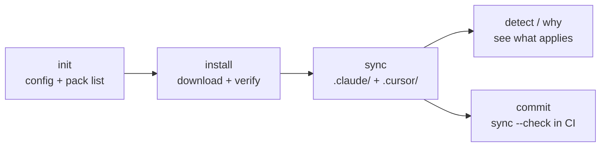

# Quickstart

The shortest working install: one existing project, four commands, nothing to write by hand. This walkthrough was run against the published **bluetemberg 0.20.0** (and, with the same result, 0.19.0) in a fresh directory with an empty npm cache, on a Next.js 15 app with a `package-lock.json`. It took under a minute.

You need Node.js 20+ and a project with a `package.json`. Commit or stash your work first so the diff is easy to read.



## 1. Pick a profile and platforms

```bash
npx bluetemberg init --non-interactive --profile frontend --platforms claude,cursor --omit-github
```

Pick the profile closest to your role: `frontend`, `backend`, `fullstack`, `devops`, `pure-infra`, `agentic` or `design-engineer` (`npx bluetemberg preview --list` describes each, and `npx bluetemberg preview <profile>` lists the packs it preselects). Pick the platforms your team uses: `cursor`, `claude`, `copilot`, `gemini`, `antigravity`, `devin`, `codex`. `--omit-github` skips the optional GitHub repository files (Dependabot, templates, LICENSE, …); leave it off if you want them.

`init` writes:

- `bluetemberg.config.json`: the platforms, the profile and the output targets
- `llm/packages.json`: the packs the profile preselects, each with a semver range. Stack-specific packs are included only when their stack is in the project; on the Next.js app that added `bluetemberg-rules-nextjs` and `bluetemberg-skills-nextjs-caching`
- `AGENTS.md`, plus a `CLAUDE.md` that imports it, and `llm/mcp.json`
- `sync:llm-config` and `sync:llm-config:check` scripts in `package.json`, and `.bluetemberg/` in `.gitignore`

`init` ends with a first sync. The packs are not downloaded yet, so that sync prints one warning per pack, `… is in the manifest but has no lockfile entry. Run "bluetemberg install".` That is expected.

## 2. Install and verify the packs

```bash
npx bluetemberg install
```

Each pack is downloaded from npm into `.bluetemberg/packs/` (gitignored), and refused unless its SHA-512 integrity and its npm registry signature check out and the [content scan](Registry#content-scan) finds nothing blocking. The resolved versions and hashes go into `llm/packages-lock.json`. Commit `llm/packages.json` and the lockfile.

From 0.20.0, `install` also prints a capability report: what each pack can make your tools run or block, so you review behaviour rather than prose:

```text
Installing 28 pack(s)...

  bluetemberg-skills-pr-review-loop@0.4.0 can run or gate:
    + skill file: skills/pr-review-loop/scripts/post-review-comment.sh
    …
  bluetemberg-guardrails-git@0.2.2 can run or gate:
    + guardrail: conventional-branch-names (gates EnterWorktree)

Installed 28 pack(s).
```

The count depends on the profile, the detected stacks and the current catalog.

## 3. Write each tool's config

```bash
npx bluetemberg sync
```

```text
Rules: 42 source files
  41 applied · 1 filtered out by version
    - i18n-payload-localized-fields: payload not present
  -> .claude/rules/ (41 files)
  -> .cursor/rules/ (41 files)
Agents: 6 source files
  -> .claude/agents/ (6 files)
  -> .cursor/agents/ (6 files)
Skills: 13 source directories
  -> .claude/skills/ (13 skills)
Guardrails: 1 guardrail(s) -> .claude/settings.json
…
Done. 114 file(s) written.
```

Every rule is written in each tool's own format (`.mdc` with `globs` for Cursor, `paths` for Claude Code), and rules whose `stacks:` range does not match the project are left out and listed. With Claude Code enabled, skills go to `.claude/skills/`, which Cursor also reads. See [How sync works](https://github.com/prototypdigital/bluetemberg#how-sync-works) for every platform.

Without a lockfile, stack versions are read from the `package.json` range and sync warns that the detection is low-confidence. Run your package manager's install first, or pin the version in `bluetemberg.config.json` `stacks`.

## 4. See what applies, and why

```bash
npx bluetemberg detect
```

```text
Detected stacks (2):
  ✔ nextjs 15.5.29  exact (package-lock.json)  covered (>=13.4)
  ✔ react 19.3.1  exact (package-lock.json)  covered (name-level only)
```

Ask about any rule, agent, skill or guardrail by id or path:

```bash
npx bluetemberg why nextjs-server-components
```

```text
rules/nextjs-server-components: INCLUDED — stack constraint satisfied (nextjs *)
  source:     bluetemberg-rules-nextjs@0.5.0 (.bluetemberg/packs/bluetemberg-rules-nextjs/0.5.0/llm/rules/nextjs-server-components.md)
  constraint: catalog pack-level tag of bluetemberg-rules-nextjs (name-only, any version)
    ✔ nextjs "*" vs 15.5.29 (exact, from package-lock.json)
  outputs:    .claude/rules/nextjs-server-components.md, .cursor/rules/nextjs-server-components.mdc
```

`npx bluetemberg why --diff nextjs@16.0.0` shows what an upgrade would add or remove, without writing anything.

## 5. Commit, then keep it honest in CI

Commit the generated files, so teammates and CI see exactly what each tool loads. In CI:

```bash
npx bluetemberg install
npx bluetemberg verify
npx bluetemberg sync --check
```

`verify` re-checks integrity and registry signatures; `sync --check` exits 1 when a generated file has drifted from its source. Teammates who clone the repo run `npx bluetemberg install` once.

## Undo

```bash
npx bluetemberg uninstall --dry-run
npx bluetemberg uninstall
```

`uninstall` removes the generated files and bluetemberg's state and keeps what you wrote; `eject` keeps the generated files as plain files you own. See [Commands](Commands#bluetemberg-uninstall-directory).

## Next

- [Profiles](Profiles): what each profile preselects
- [Consumer Setup](Consumer-Setup): the full setup, including your own rules and CI
- [Stacks](Stacks): how versions are detected and matched
- [Guardrails](Guardrails): checks the tools enforce rather than suggest
- [Registry](Registry): the manifest, the lockfile and private registries
