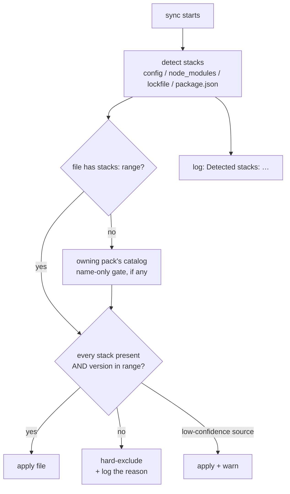

# Stacks & Versioning

Bluetemberg routes content along two orthogonal axes:

- **Profile** (the *role* you build in) — frontend, backend, full-stack. See [Profiles](Profiles).
- **Stack** (the *technology* you build with, and at which **version**) — `react`, `nextjs`, `payload`, … This page covers the stack axis and how version-aware routing works.

The goal: a rule written for Payload v3 should never reach a Payload v2 project, and a React 14 rule and a React 15 rule can coexist in one pack with the right one served to each project — automatically, and **visibly**.

## The model: stack name + range, never a versioned stack name

A stack is an open-vocabulary **name** (`react`). A version is a **constraint** layered on top via a semver range. There is no `react-14` stack — there is `react` plus a range like `>=14 <15`.

This appears in three places:

| Where | Field | Shape | Purpose |
|---|---|---|---|
| A project | [`stacks` config](Configuration#stacks) | `{ "react": "15.2.0" \| "auto" }` | Declares/pins what the project builds on |
| A rule, guardrail, agent, or skill | [`stacks:` frontmatter](Writing-Rules#stacks-optional) | `{ react: ">=15 <16" }` | Declares which versions the content applies to |
| A catalog pack | `stacks` (name-only) | `["react"]` → `{ react: "*" }` | Coarse name-level routing; a file's own range refines it |

A catalog pack's `stacks` only apply to **that pack's own files** — ones found in a source dir whose `package.json` names the pack (installed packs, npm or local-path `extends`). A project's own `llm/rules/naming.md` is never withheld because some React pack also ships a `naming` rule, and it contributes no coverage for React either.

A file applies **iff every named stack is present in the project AND its detected version satisfies the range**. An absent/empty constraint is stack-agnostic and always applies — so a project with no stack-tagged content behaves exactly as a stackless project always did.

### React 14 and React 15, both valid — in one pack

```
bluetemberg-rules-react/
  rules/
    effects-r14.md   →  stacks: { react: ">=14 <15" }   # "use the old API"
    effects-r15.md   →  stacks: { react: ">=15 <16" }   # "use the new API"
    naming.md        →  (no stacks key)                 # universal — both get it
```

A React 14 project receives `effects-r14` + `naming`; a React 15 project receives `effects-r15` + `naming`. Both variants are maintained and valid; the gate serves the right one. A range is a full semver expression, so a single rule can also span versions explicitly: `react: "14.x || 16.x"`.

## Detection: where a version comes from, and how much we trust it

When a stack is not pinned in config (or is set to `"auto"`), Bluetemberg resolves its version per sync. Each detected stack carries a **confidence** and a **source**, in precedence order:

| Precedence | Source | Confidence | Notes |
|---|---|---|---|
| 1 | `bluetemberg.config.json` `stacks` (pinned, not `"auto"`) | `declared` | Asserted as fact — cheap and deterministic |
| 2 | `node_modules/<pkg>/package.json` | `exact` | The installed truth |
| 3 | `package-lock.json`, `pnpm-lock.yaml` or `yarn.lock` | `exact` | Resolved lockfile version — see [Lockfiles](#lockfiles) |
| 4 | `package.json` dependency range (coerced) | `coerced` | Low confidence — a range like `^15` coerces to its lowest anchor |

Steps 2 and 3 follow Node's own module resolution. In a workspace, a package whose dependency was **hoisted** resolves it from the workspace root's `node_modules` (source shown as `../../node_modules`), and from the root `package-lock.json`, where an entry nested under the package's own path (`packages/legacy/node_modules/react`) wins over the hoisted one. The climb stops at the nearest repo/workspace boundary — a directory with `.git`, a lockfile, `pnpm-workspace.yaml`, or a `package.json` with `workspaces` — so detection never reads an unrelated parent directory. The version reported is the one the package actually runs, not a coerced guess.

### Lockfiles

Without `node_modules`, the lockfile still gives an exact version for npm, pnpm and yarn projects. Each workspace package is resolved from **its own** entry, so two packages on different versions of one stack each get their own:

| Lockfile | Formats read | How a package's dependency is found |
|---|---|---|
| `package-lock.json` | lockfileVersion 1, 2, 3 | `packages/<pkg-path>/node_modules/<dep>`, then the hoisted `node_modules/<dep>` |
| `pnpm-lock.yaml` | 5.x (pnpm 7), 6.0 (pnpm 8), 9.0 (pnpm 9–11) | the package's `importers` entry (`packages/web`, or `.` at the root) |
| `yarn.lock` | v1 (classic) and berry (yarn 2+) | v1: the `name@<range>` entry for the package's own `package.json` range; berry: the descriptor the workspace entry (`web@workspace:packages/web`) lists |

What the readers handle:

- **pnpm:** `catalog:` specifiers, `overrides` and `patchedDependencies` (the importer already records the resolved version), peer suffixes (`14.2.3(react@18.3.1)`, 5.x `13.4.0_<hash>`), and the config-dependency document pnpm 11 writes ahead of the project's own. Only the part before `packages:` is parsed, so a large lockfile stays cheap.
- **yarn berry (2, 3 and 4):** root `resolutions` as yarn applies them — the first matching key wins, a parent-scoped key (`web/react`) overrides that workspace's own dependency, and glob keys (`**/react`), which yarn ignores, are ignored too. Also `patch:` descriptors, and `catalog:` read from `.yarnrc.yml`. A remote scan has no `.yarnrc.yml`, so it answers a `catalog:` dependency only when every lockfile entry for the package is the same version of the package itself, and falls back to the range otherwise.
- **yarn v1:** entries keyed by several specs (`react-dom@^18.2.0, react-dom@^18.3.0:`); `resolutions` are already reflected in the version.
- **Aliases:** `npm:same-name@1.2.3` resolves; an alias to another package (`"svelte": "npm:preact@10.19.0"`, or a berry `patch:` of one) is never reported as that stack — not from any lockfile, and not from the range either.
- **Not versions:** a workspace link (`link:`, `workspace:`, berry `portal:`) or a local directory resolves to nothing, and the range is used instead. A git or tarball dependency resolves to nothing from `pnpm-lock.yaml`, which records only the URL; npm and yarn lockfiles record the installed package's own `version`, and that is reported.

A lockfile that can't be used — malformed (a merge conflict left in it, say), an unrecognised format, or over 64 MiB — never fails detection. It falls back to the coerced `package.json` range and warns once, with the same line in `sync`, `why`, `detect` (`level: "lockfile"`) and `scan-org`:

```text
WARN: yarn.lock could not be parsed (line 3: expected an entry header) — using package.json ranges for stack versions
```

When one directory holds several lockfiles, only one is read: the one the `package.json` `packageManager` field names (`pnpm@9.15.0` → `pnpm-lock.yaml`), else the first in the order of the table. A stale `package-lock.json` left in a pnpm repo is therefore never preferred, and a remote scan reads the same file. An implied stack (`react` from `nextjs`) resolves from `node_modules` or from `package-lock.json`'s hoisted entry; pnpm and yarn lockfiles key versions by what each package declares, so from them an implied stack resolves only when the package lists it.

**Prereleases** are matched as the release they preview: `19.0.0-rc.1` is treated as `19.0.0`. Plain semver sorts an RC *below* `19.0.0`, which would give a team trying the next major the previous major's rules (`>=18 <19.0.0` matches) and not the new ones (`>=19.0.0` does not).

### The stack map: which package is a stack?

Detection needs to know which package carries a stack's version: `nextjs` is the `next` package, `angular` is `@angular/core`. That map has two layers, merged per stack:

1. **The built-in table** in the engine: `nextjs` → `next`, `react`, `payload`, `angular` → `@angular/core`, `vue`, `svelte`, `astro`, `solid` → `solid-js`, `tailwind` → `tailwindcss`, `drizzle` → `drizzle-orm`, `trpc` → `@trpc/server`. It is the fallback, and the whole map for any catalog that does not carry one.
2. **The catalog's `stackPackages` block**, owned by [bluetemberg-packs](https://github.com/prototypdigital/bluetemberg-packs). A pack that targets a new stack can make it detectable without an engine release.

```json
"stackPackages": {
  "schema": 1,
  "stacks": {
    "expo": { "packages": { "npm": "expo" }, "implies": ["react-native"] },
    "react-native": { "packages": { "npm": "react-native" }, "implies": ["react"] },
    "nextjs": { "implies": ["react"] }
  }
}
```

- **The catalog wins over the built-in table, field by field.** An entry's `packages.npm` replaces the built-in package for that stack; leave it out (as `nextjs` does above) to keep the built-in one. The catalog can add or remap a stack, never delete a built-in one.
- **`implies` lists stacks that come along.** When `nextjs` is detected, `react` becomes a candidate too, and is resolved from its own package like any other stack. An implied stack is only reported when `node_modules` or the lockfile actually has it (source shown as `node_modules, implied by nextjs`); it is never coerced from a range the project does not declare. Implication is transitive, and a cycle simply stops.
- **One package, one stack.** Two stacks that map the same package warn, because both names are detected and `scan-org` counts each repo twice. That includes a catalog entry that reuses a built-in stack's package under a new name: a built-in cannot be deleted, so this adds an alias rather than a rename. Use the existing name instead.
- **`packages` is keyed by ecosystem.** Only `npm` is read today, because detection only reads `package.json`, `node_modules` and the npm, pnpm and yarn lockfiles. Other keys (`pypi`, …) are kept for future readers and ignored now, so a stack mapped only to another ecosystem behaves like an unmapped one: it is never auto-detected, even when an npm package shares its name, and is resolved by its own name only when declared in config or implied.
- **No field for calendar or channel versions.** npm requires every published version to be semver, so a calendar-versioned package (`2024.10.1`) already compares correctly, and a release channel (`15.4.0-canary.12`) is handled by the prerelease rule above. A future ecosystem that needs version normalization gets it through a new `schema`.
- **Which catalog.** Detection reads the same catalog every other command does, and never the network, so it works offline:
  1. the project cache, `.bluetemberg/catalog.json`, refreshed by `add`, `install` (not `--dry-run`), `update` and `preview`. A monorepo package with no cache of its own reads the nearest one above it, up to the directory holding `.git`, so a package uses the catalog its repo installed from.
  2. otherwise, the snapshot committed in the engine.

  `sync` and `why` load the catalog once and hand the same map to detection, so they cannot disagree. `scan-org` detects every repo, local or remote, with the scanner's own catalog, so one scan uses one vocabulary. `why --diff` overrides only the stacks you name; implied stacks keep the versions detected for them.

**Compatibility.** Engines before this block ignore it and use their built-in table. A catalog without the block (every snapshot before it) gives today's behaviour exactly. A `schema` newer than the engine reads is ignored as a whole, with a warning to upgrade. Inside a known schema, unknown fields are ignored. A malformed block or entry never breaks detection. The bad entry is dropped, the built-in mapping (if any) stays, and `sync`, `why`, `detect`, `scan-org` and `stacks lint` warn:

```
WARN: catalog stackPackages.stacks.expo: "packages.npm" is not a valid npm package name — ignored, the stack stays unmapped
```

#### Adding a mapping (packs repo)

Mappings live in the packs repo's `catalog.json`, next to the packs that target the stack:

1. Add the stack under `stackPackages.stacks`, named exactly as packs tag it in `bluetemberg.stacks` and as rules spell it in `stacks:` frontmatter.
2. Set `packages.npm` to the package whose installed version *is* the stack's version (for example, the framework's core package, not a CLI or a plugin).
3. Add `implies` only for stacks the project is guaranteed to install alongside it, and that guidance gates on.
4. Check it from a project that uses the stack: `bluetemberg detect --json` should list the stack with `exact` confidence and no `stack-map` warning. In the packs repo itself, `bluetemberg stacks lint` already looks packages up through the repo's own `catalog.json`, so a new mapping is linted before it ships.

The engine picks the mapping up through the catalog cache; the committed snapshot follows on the engine's next `npm run sync:catalog`.

Inspect what the engine resolves with [`bluetemberg detect`](Commands#bluetemberg-detect-directory).



## Audible filtering — you can always see what the gate did

Filtering is a **trust signal**, not a silent side effect. A normal (non-`--silent`) sync reports exactly what it matched against and what it withheld:

```
Detected stacks: nextjs@15.2.0 (node_modules), payload@3.4.1 (config)

Rules: 12 source files
  10 applied · 2 filtered out by version
    - payload-collections: payload >=3 <4 (you're on 2.5.0)
    - next-rsc: nextjs not present

Guardrails: 1 filtered out by version
  - payload-2-only: payload >=2 <3 (you're on 3.4.1)
```

Three guarantees back this up — guidance is **never silently dropped**:

- **A typo'd range warns instead of vanishing.** An invalid range (`react: "15..16"`) would otherwise be dropped, silently widening the file to apply everywhere. Instead:
  ```
  WARN: rules/effects-r15.md: invalid stack range(s) react: "15..16" — fix the range; until then the file is mis-gated
  ```
  A valid range that no version can satisfy (`payload: ">=4 <3"`) warns the same way, tagged `(matches no version)` — otherwise it excludes the file forever.
- **A low-confidence match warns — once per stack.** A version coerced from a `package.json` range still applies, but tells you to pin it. One line per stack, not per file, so the signal isn't drowned:
  ```
  WARN: payload@3.4.0 is a low-confidence detection (coerced, from package.json) gating version-tagged files (first: rules/payload-collections.md) — pin a version in bluetemberg.config.json for precision
  ```
- **Two sources shipping the same file warns.** When two packs (or `extends` entries) both ship `rules/testing.md`, the higher-priority one wins and the other copy — with its own `stacks:` range — is ignored. Sync names both. A local copy is the deliberate override and stays quiet.
- **Every exclusion lists its reason** (rules, guardrails, agents, and skills alike), so you can audit that wrong-version content was correctly withheld — hidden, not wrong-here.
- **You can ask about any one file.** `bluetemberg why <file>` explains a single rule, agent, skill or guardrail: which source it came from, whether its constraint is its own `stacks:` or its pack's catalog tag, the detected version and confidence it was checked against, and the verdict. `bluetemberg why --diff payload@4` previews what an upgrade would add and remove before you bump the dependency. Both use the gate itself, so they can't disagree with sync. See [Commands](Commands#bluetemberg-why-file-directory).
- **The gate applies on every platform, Codex included.** A withheld rule stays out of the managed rules block in `AGENTS.md`, and a withheld agent gets no `.codex/agents/*.toml`. Claude Code and Copilot read `AGENTS.md` too, so a rule that leaked into that block would reach them as well.

## Coverage: the same model, asked backwards

Gating asks *"does this file apply to my project?"*. Coverage asks the inverse — *"is there guidance for what I build with?"* — and answers it from the same declared ranges, so the two can never disagree.

The **covered ranges** for a stack are the `stacks:` ranges declared by the guidance actually available (the project's own source dir, `extends` entries, installed packs, external sources), resolved with the same precedence the gate uses: a file's own range wins, else the catalog pack-level tag (`*`, name-level), else stack-agnostic (contributes nothing). A stack with any declared range never falls back to `*` — otherwise the wildcard would satisfy every version and flatten coverage back into "does a react pack exist?".

A query for `(stack, version)` therefore has four outcomes:

| Outcome | Meaning |
|---|---|
| `covered` (matched range) | A declared range satisfies the version — e.g. `react: ">=18 <19"` covers `18.3.1` |
| `covered` (name-level, `*`) | A catalogued pack targets the stack, but nothing declares a version range for it — real guidance, not *version* guidance, so it ranks in its own `weakCoverage` tier |
| gap: `version-uncovered` | Guidance for the stack exists, but no covered range satisfies this version — *"we ship React 18 rules; this repo is on 19"* |
| gap: `no-coverage` | Nothing targets this stack at all |

Note the third row carefully: a single stack-agnostic file inside a pack the catalog tags `["react"]` covers *every* React version. Coverage says so honestly — that file really does apply — but a version era whose only guidance is generic is not the same as one with a rule written for it, so those buckets are ranked separately rather than folded into "covered".

Read it with [`bluetemberg detect`](Commands#bluetemberg-detect-directory) and [`bluetemberg coverage`](Commands#bluetemberg-coverage-stackversion-directory) for one project, or [`bluetemberg scan-org`](Commands#bluetemberg-scan-org-paths) to rank across N repos by how many are affected: `gaps` first (nothing covers them), then `weakCoverage` (covered name-level only).

## Range lifecycle: bounded ranges, checked against real releases

A range is a claim that the guidance is right for those versions. `>=3` claims Payload 4, 5 and 6 too — versions that did not exist when the rule was written. The day Payload 4 ships, every Payload-4 project receives the rule, and coverage reports Payload 4 as `covered`, with nothing to say whether anyone checked. The same happens, more quietly, with a bounded range that reaches past the latest release (`>=3 <6` while Payload is on 3).

[`bluetemberg stacks lint`](Commands#bluetemberg-stacks-lint-directory) flags both: `open-ended` ranges, and `past-latest-major` ranges checked against the stack's latest release on npm (cached, and degrading to an "unchecked" note offline rather than guessing). The fix is the same either way — bound the range to the majors you checked (`>=3 <4`), and widen it when you check the next one. When a new major ships, [`bluetemberg stacks list payload@3`](Commands#bluetemberg-stacks-list-stackversionrange-directory) lists every rule pinned to the old one: the review list for the new major.

Both commands run on a consuming project (the guidance it has available) or on a packs repo (where rules are authored), so a maintainer can lint before publishing and a team can see what it actually installed.

## Versioning strategy: two tiers, mirroring the ecosystem

When a stack's guidance differs across versions, there are two established ways to model it. Bluetemberg follows both, at different scales — the same pattern TypeScript and DefinitelyTyped use:

| Tier | Pattern | Industry analog | Bluetemberg |
|---|---|---|---|
| **1** | One artifact, **version-keyed selector** — ship all variants, the consumer's version picks | TS [`typesVersions`](https://www.typescriptlang.org/docs/handbook/declaration-files/publishing.html); browserslist + `@babel/preset-env` | **Per-rule `stacks:` range** — available now |
| **2** | **Separate published version lines** — fork the package when the delta is too big for one | `@types/react@16` vs `@17` vs `@18`; `react-router@5` vs `@6` | `stackPeerDependencies` (pack version forks per stack) — *roadmap* |

The switch rule both ecosystems use: **use the in-artifact selector (Tier 1) until the divergence breaks it, then fork the version line (Tier 2).** For the React 14/15 case, Tier 1 is almost always sufficient — keep both rule sets in one pack and let the range gate serve each. Reach for Tier 2 only when one pack genuinely cannot hold both cleanly.

> Most AI-rules tools bake the framework version into prose ("you are an expert in React 19…"). Bluetemberg's structured, range-based gating — plus the audible output above — is the differentiator. Keep version a *constraint*, never part of a stack name.

## Known limits

Version-aware routing is maturing. Tracked in [issue #212](https://github.com/prototypdigital/bluetemberg/issues/212):

- **Monorepos: solved per-package, not per-version-within-a-package.** A monorepo with `react@14` in one package and `react@15` in another is handled — `bluetemberg sync` [fans out](Commands#bluetemberg-sync-directory) and gates each package against its own detected stacks. What's still not expressible is *two versions of one stack inside a single package* (the detection model resolves one version per stack name per directory).
- **Cross-stack matching is AND-only.** "applies to A≥3 *or* B≥2" across two different stacks is not expressible (OR *within* one stack via `||` is).
- **Only npm packages are detected.** The [stack map](#the-stack-map-which-package-is-a-stack) is data, but the readers are not: a stack is auto-detected only when the map (built-in or catalog) names its npm package. Any other stack is detected only when declared in config.
- **Some lockfile entries can't be mapped.** A berry `catalog:` dependency in a remote scan with several versions of the package locked, a GitHub shorthand (`user/repo`) in berry, and a lockfile older than pnpm 7's format fall back to the coerced range. Remote `scan-org` reads the lockfile beside the root `package.json` only.

## See also

- [Configuration → `stacks`](Configuration#stacks) — declaring/pinning project stacks
- [Writing Rules → `stacks`](Writing-Rules#stacks-optional) — the frontmatter constraint
- [Commands → `bluetemberg detect`](Commands#bluetemberg-detect-directory) — inspect resolved versions
- [Commands → `bluetemberg stacks lint`](Commands#bluetemberg-stacks-lint-directory) — flag ranges nobody has checked
- [Guardrails](Guardrails) — the same gate applies to guardrails
- [Drafts](Drafts) — fill a gap: a grounded draft rule, checked, promoted by a human
