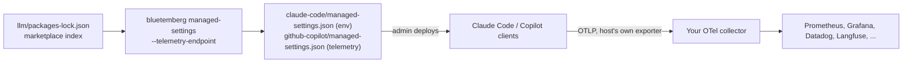

# Telemetry

> **Since 0.20.0.** Not in the npm release until 0.20.0 is published (0.19.0 is the latest there as of this writing).

`bluetemberg managed-settings --telemetry-endpoint <url>` adds OpenTelemetry export to the org policy files it generates. Each AI coding host then sends its own metrics and events to **your** OTLP collector. bluetemberg itself never sends, collects or stores anything. It has no telemetry of its own. These keys only configure the hosts.

Telemetry is opt-in. Without `--telemetry-endpoint`, the files carry no telemetry keys at all.

## Why org policy, not `sync`

A repository can't turn telemetry on:

- Claude Code (v2.1.282 and later) ignores every variable that turns telemetry on, picks an exporter or endpoint, or captures content when it is set in a project's `.claude/settings.json`.
- Codex ignores `[otel]` in a project's `.codex/config.toml`.
- Cursor configures export only in its Team Settings dashboard.

So `sync` writes nothing for telemetry. The policy files from [Org rollout](Org-Rollout) are where an admin can turn it on for everyone.



## Usage

```bash
npx bluetemberg managed-settings --ref v1.4.0 \
  --telemetry-endpoint https://otel.internal.example.com \
  --telemetry-attribute team.id=platform
```

| Flag | Notes |
| - | - |
| `--telemetry-endpoint <url>` | Collector base URL. The hosts add `/v1/metrics` and `/v1/logs` themselves, so a URL already ending in `/v1/<signal>` is refused. A URL with a user, password, query string or fragment is refused, so a token can't end up in the policy file. It warns on plain `http://` to a non-local host, and on a path segment that looks like an ingest key |
| `--telemetry-protocol <protocol>` | `http/protobuf` (default), `http/json`, or `grpc`. Copilot exports over HTTP only, so `grpc` is refused unless `--host claude` |
| `--telemetry-attribute <key=value>` | Extra resource attribute (repeatable). Keys under `bluetemberg.` are reserved. Keys that look like credentials (`token`, `secret`, `api_key`, ...) and values shaped like known tokens (`ghp_`, `sk-`, `eyJ`, `AKIA`, ...) are refused |

The generated `README.md` gets a **What is sent, and where** section that lists the endpoint, the signals and every attribute.

## What each host gets

| | Claude Code | GitHub Copilot |
| - | - | - |
| Key | `env` | `telemetry` |
| Turned on | `CLAUDE_CODE_ENABLE_TELEMETRY=1`, `OTEL_METRICS_EXPORTER=otlp`, `OTEL_LOGS_EXPORTER=otlp` | `enabled: true` |
| Off | `OTEL_TRACES_EXPORTER=none` (traces are beta) | Copilot's traces stay on. They carry no content with capture off |
| Destination | `OTEL_EXPORTER_OTLP_ENDPOINT`, `OTEL_EXPORTER_OTLP_PROTOCOL` | `endpoint`, `protocol` |
| Content capture | `OTEL_LOG_USER_PROMPTS`, `OTEL_LOG_ASSISTANT_RESPONSES`, `OTEL_LOG_TOOL_DETAILS`, `OTEL_LOG_TOOL_CONTENT` all `0` | `capture.*` all `false`, `lockCaptureContent: true` |
| Attribution | `OTEL_RESOURCE_ATTRIBUTES` (values percent-encoded) | `resourceAttributes` |
| Clients | CLI, IDE extensions, Desktop. Cloud sessions read only server-managed settings | CLI, VS Code, the Copilot app, JetBrains. Not cloud sessions |

Managed values beat user and project settings in both hosts. So the content switches are locked off: a developer can't turn prompt logging on and send their prompts to the org collector.

### What Claude Code sends with these settings

- **Metrics:** sessions, tokens and cost (by model, and by `query_source` main or subagent), lines changed, commits, pull requests, active time, and edit accept/reject decisions.
- **Events:** prompt *length*, tool name, success and duration, and API request model, tokens, cost and errors.
- **Redacted:** prompts, responses, tool input and output, and Bash commands. Custom skill, plugin and MCP names appear as `custom` / `third-party` while `OTEL_LOG_TOOL_DETAILS` is `0`. The `bluetemberg.*` attributes are how you attribute behaviour to your packs without unredacting tool details.
- **Identity:** when a user is signed in, Claude Code always attaches `user.email`, `user.account_uuid` and `organization.id`. No setting removes them, so drop them in the collector if you don't want them stored (see below).

## Pack attribution

Every metric and event carries:

| Attribute | Value |
| - | - |
| `bluetemberg.marketplace` | The marketplace name from `.claude-plugin/marketplace.json` |
| `bluetemberg.marketplace.ref` | The `--ref` the policy pins, when given |
| `bluetemberg.packs.digest` | `sha256:<16 hex>` over the sorted `name@version integrity` of every pack the bundles were built from |
| Your `--telemetry-attribute` keys | As given |

The digest changes exactly when a pack version changes. You don't get one label per pack, which would add a label to every series. Instead, the generated README's **Pack versions** table maps the digest to the packs. Keep each generated README (in git, next to the policy) and you can tell which pack versions any digest stood for.

### One attribute list per host

Each host takes one value per managed source:

- Claude Code merges managed `env` **per variable**, so a different drop-in or MDM profile that sets `OTEL_RESOURCE_ATTRIBUTES` replaces ours, or ours replaces it.
- Copilot takes the **whole** `telemetry` object from the highest-precedence managed source.

If you already label telemetry, for example with `department` or `team.id`, pass those keys with `--telemetry-attribute` so they all end up in one list.

The same goes for the rest of the block. Deployed as a Claude Code drop-in, the generated `env` replaces the same variables in your main managed file: the endpoint, the protocol, and the content switches. If your org deliberately captures prompts or tool details today, this policy turns that off.

The digest is computed from the Agent Plugins bundle locks when they exist. Otherwise it comes from `packages-lock.json`, and the command warns that it only labels what users run if the published marketplace was built from that lockfile.

## Authentication

No header or token is ever written: a policy file is readable by every user on the machine. Use the host's header helper, which runs a command and keeps the token out of the file:

- Claude Code: add `otelHeadersHelper` (a script that prints a JSON object of headers) to the deployed file. It works for `http/*` protocols only.
- Copilot: add `telemetry.headersProvider`.

Or run the collector on a network the clients can reach without credentials, and put the authentication on the collector's outbound side.

## Collector example

A minimal [OpenTelemetry Collector](https://opentelemetry.io/docs/collector/) config. It receives OTLP, drops identity attributes you don't want stored, and exposes metrics to Prometheus:

```yaml
receivers:
  otlp:
    protocols:
      http:
        endpoint: 0.0.0.0:4318
      grpc:
        endpoint: 0.0.0.0:4317

processors:
  batch: {}
  attributes/drop-identity:
    actions:
      - { key: user.email, action: delete }
      - { key: user.account_uuid, action: delete }
      - { key: user.account_id, action: delete }

exporters:
  prometheus:
    endpoint: 0.0.0.0:8889
    resource_to_telemetry_conversion:
      enabled: true
  debug: {}

service:
  pipelines:
    metrics:
      receivers: [otlp]
      processors: [attributes/drop-identity, batch]
      exporters: [prometheus]
    logs:
      receivers: [otlp]
      processors: [attributes/drop-identity, batch]
      exporters: [debug]
```

Prometheus turns the dots in attribute names into underscores. Example queries:

```promql
# Claude Code cost per day, by pack set
sum by (bluetemberg_packs_digest) (increase(claude_code_cost_usage_USD_total[1d]))

# Edit rejection rate before and after a pack upgrade
sum by (bluetemberg_packs_digest) (rate(claude_code_code_edit_tool_decision_total{decision="reject"}[1d]))
  /
sum by (bluetemberg_packs_digest) (rate(claude_code_code_edit_tool_decision_total[1d]))
```

Exact metric names depend on your exporter's unit and suffix handling. Check them in your backend.

## Not covered (yet)

- **Codex**, **Gemini CLI**: planned as further managed-settings hosts. Gemini CLI logs prompts by default (`logPrompts: true`), so its policy will always write `false`. Codex also sends anonymous usage data to OpenAI unless `[analytics] enabled = false`, separately from `[otel]`.
- **Cursor**: export is set up by a team admin in Team Settings → OpenTelemetry Export (Enterprise). There is nothing for bluetemberg to generate.
- **Antigravity, Devin Desktop**: no documented export.
- **OTel GenAI semantic conventions** are still Development status, and hosts adopt them only partly. bluetemberg adds only its own `bluetemberg.*` attributes and leaves normalizing across hosts to your collector or dashboards.

Sources (checked 2026-11-04):

- Claude Code: [Monitoring](https://code.claude.com/docs/en/monitoring-usage), [Settings reference](https://code.claude.com/docs/en/settings-reference#variables-claude-code-ignores-in-env), [Managed settings](https://code.claude.com/docs/en/managed-settings)
- GitHub: [Enterprise managed settings reference](https://docs.github.com/en/copilot/reference/enterprise-managed-settings-reference#telemetry), [OpenTelemetry for agent monitoring](https://docs.github.com/en/copilot/concepts/agents/opentelemetry)
- Others: [Codex advanced config](https://learn.chatgpt.com/docs/config-file/config-advanced), [Cursor OpenTelemetry Export](https://cursor.com/docs/enterprise/opentelemetry-export), [Gemini CLI telemetry](https://geminicli.com/docs/cli/telemetry/), [OTel GenAI semantic conventions](https://github.com/open-telemetry/semantic-conventions-genai)
